# Rapport des simulations – TP de modulation (AM, FM, PAM, PWM)

Ce rapport est produit automatiquement par GitHub Actions (`.github/workflows/simulations.yml`).
Chaque TP compare les valeurs relevées dans la vidéo avec une simulation.

Légende : ✅ confirmé · ❌ écart (la simulation contredit la vidéo) · ⚠️ à vérifier (dépend d'une valeur inconnue) · ℹ️ valeur prédite

## Synthèse

| TP | Sujet | ✅ | ❌ | ⚠️ | ℹ️ |
|---|---|---|---|---|---|
| TP01 | AM – maquette Omega ETB-96 (2 transistors BF-195, détecteur OA-79) | 4 | 2 | 0 | 7 |
| TP02 | FM – maquette FM Modulation & Demodulation (VCO + PLL) | 6 | 3 | 0 | 2 |
| TP03 | PAM naturel, sample & hold et flat-top – Scientech ST2110 | 5 | 0 | 0 | 2 |
| TP04 | PWM – Scientech ST2110 (comparateur message / rampe) | 2 | 0 | 0 | 1 |
| TP05 | PWM – Excel Technologies ET-PWM (1 kHz / 8 kHz) | 2 | 0 | 0 | 1 |
| TP06 | PWM – Akademika DCL-08 (caractéristique largeur / tension, déphasage) | 2 | 0 | 1 | 0 |
| TP07 | FM avec le générateur de fonctions ICL8038 | 4 | 0 | 1 | 3 |
| TP08 | PAM – maquette Excel Technologies (1 kHz / 8 kHz) | 1 | 0 | 1 | 2 |
| TP09 | Démodulation FM par boucle à verrouillage de phase LM565 | 7 | 1 | 1 | 0 |
| TP10 | FM avec un NE555 (astable, message sur la broche 5) | 2 | 5 | 2 | 4 |
| TP11 | AM à transistor BC107BP + détecteur d'enveloppe (ngspice) | 4 | 3 | 1 | 1 |
| TP12 | PAM et démodulation – Scientech ST2110 (8 / 16 / 32 / 64 kHz) | 2 | 0 | 0 | 1 |
| TP13 | PAM avancé – Vinytics CT-PAM ADV (fs 2 à 64 kHz, filtres d'ordre 2 et 4) | 2 | 0 | 0 | 2 |

**Total : 43 confirmés, 14 écarts, 7 à vérifier, 26 valeurs prédites.**

## Doutes du cours et résultat des simulations

8 doutes levés, 5 réduits, 8 restent ouverts.

| TP | Doute | Résultat | Explication |
|---|---|---|---|
| TP01 | Le détecteur de la maquette restitue-t-il le message de 10 kHz utilisé dans la vidéo ? | 🟢 levé | Non : ngspice (diode germanium SPICE) donne un SINAD de 10,9 dB à 10 kHz contre 43,8 dB à 1 kHz. La constante de temps 10 kΩ × 0,01 µF = 100 µs est faite pour un message audio de 1 à 2 kHz. |
| TP01 | Circuit interne de l'oscillateur de porteuse (≈ 133 kHz) | 🔴 reste | Il n'est pas imprimé sur la maquette : la porteuse est mesurée, pas simulée. |
| TP02 | fmin écrit 55 kHz sur la feuille | 🟢 levé | 1/38 µs = 26,3 kHz : erreur de recopie. |
| TP02 | Lecture de 3,8 div pour fmin | 🔴 reste | Un VCO symétrique donnerait ≈ 2,8 div ; le circuit interne de la maquette n'étant pas publié, seule une nouvelle mesure peut trancher. |
| TP02 | Valeurs dites à l'oral différentes du tableau final | 🔴 reste | La transcription automatique n'est pas fiable ; le tableau final reste la référence. |
| TP06 | Unité « secs » de la colonne largeur | 🟡 réduit | Des largeurs de 0,2 s sont impossibles avec l'horloge de la maquette : ce sont très probablement des ms. |
| TP06 | Fréquence du message pendant la mesure du déphasage | 🔴 reste | 500 Hz ou 1 kHz : les deux cas sont calculés, le filtre correspondant est le même (≈ 1,6 kHz à l'ordre 2). |
| TP07 | Résistance entre les broches 7 et 8 : 6,6 kΩ ou 6,8 kΩ ? | 🟢 levé | La valeur ne change pas la fréquence : la broche 8 est imposée par le générateur à travers 10 µF. 6,8 kΩ (valeur normalisée) est le plus probable, sans effet sur les mesures. |
| TP07 | Valeurs de RA et RB (illisibles) | 🔴 reste | f0 est inversement proportionnelle à RA et RB : la simulation ne peut pas les retrouver sans une mesure de f0. |
| TP07 | Amplitude du message 4 Vpp | 🟡 réduit | Avec 10 V d'alimentation, 4 Vpp sur la broche 8 surmodule le VCO (fréquence proche de zéro au sommet). Pour une FM linéaire, il faut quelques centaines de mV. |
| TP08 | « Seule l'alternance positive apparaît » | 🔴 reste | Une horloge 0/1 ne suffit pas à l'expliquer ; cela dépend du montage interne de la maquette (non publié). |
| TP09 | C1 relié à la masse (vidéo) ou à −12 V (fiche technique) ? | 🟡 réduit | Avec des alimentations stables, ngspice donne la même fréquence (9,37 kHz et 9,39 kHz). La fiche technique préfère −V pour que le condensateur suive les variations de l'alimentation ; le modèle comportemental ne peut pas reproduire cet effet de second ordre. |
| TP09 | Alimentation ±4 V (oral) ou ±12 V (écran) ? | 🟢 levé | ±4 V est hors de la plage du LM565 (±5 à ±12 V) ; ±12 V donne une plage de verrouillage de ±3,1 kHz autour de 9,4 kHz, compatible avec la démonstration. |
| TP09 | Excursion de fréquence du générateur | 🔴 reste | Non lisible dans la vidéo : la sortie démodulée lui est proportionnelle (Δf/Ko). |
| TP10 | Valeur de C1 : 0,1 µF lu, mais 11 kHz mesurés | 🟡 réduit | Deux simulateurs (Python et ngspice) donnent 5,49 kHz avec 0,1 µF et 11,7 kHz avec 47 nF. Avec R1 = R2 = 1,5 kΩ, le condensateur réel est donc ≈ 47 nF (ou les résistances sont plus petites). Seule une photo nette du montage peut trancher entre les deux. |
| TP10 | « La diode rend charge et décharge égales » | 🟢 levé | Faux avec R3 = 10 kΩ sur la broche 5 : rapport cyclique ≈ 40,8 % (seuils 2,5 V et 1,25 V). |
| TP10 | Amplitude de sortie 5,4 V sous 5 V | 🟡 réduit | Impossible pour un NE555 bipolaire (≈ 3,3 V) : 555 CMOS, sonde mal compensée ou lecture crête-à-crête avec dépassement. |
| TP11 | Le μ très faible vient-il du transistor de remplacement ? | 🟢 levé | Non. Avec un BC107 ordinaire, ngspice donne aussi μ ≈ 0,0278 avec la formule de la vidéo. La valeur faible vient des 8,3 V continus inclus dans Emax et Emin ; sans eux μ ≈ 0,129. |
| TP11 | μ = 0,029 ou 0,035 ? | 🟢 levé | Les deux sont des calculs sur des tensions absolues. La grandeur physique est μ ≈ 0,13 (partie alternative). |
| TP11 | Le démodulateur peut-il être branché directement sur la sortie AM ? | 🟢 levé | Non : il charge le circuit accordé et la modulation s'effondre ; un étage tampon est nécessaire. |
| TP11 | Référence exacte du transistor « two and triple five » | 🔴 reste | La simulation ne peut pas identifier le composant ; elle montre seulement qu'il ne change pas la conclusion. |

## TP01 – AM – maquette Omega ETB-96 (2 transistors BF-195, détecteur OA-79)

Vidéo : https://www.youtube.com/watch?v=YkTwZO9ub90  
Méthode : Modèle comportemental (Python) : signal AM idéal + détecteur diode/RC.

|  | Grandeur | Vidéo | Simulation | Commentaire |
|---|---|---|---|---|
| ✅ | Fréquence du message | 4 div × 25 µs → 10 kHz (générateur : 10,0517 kHz) | 10 kHz | écart avec l'affichage du générateur : -0,51 % |
| ✅ | Fréquence de la porteuse | 3 div × 2,5 µs → ≈ 133 kHz | 133,3 kHz | lecture ± 0,2 div → porteuse entre 125 kHz et 143 kHz |
| ✅ | Vmax / Vmin de l'enveloppe | 4,8 V / 0,8 V | 4,8 V / 800 mV | crêtes de chaque cycle de porteuse (lecture aux curseurs simulée) |
| ✅ | Taux de modulation m | 0,714 (71,4 %) | 0,714 (71,4 %) |  |
| ℹ️ | Raies latérales (fc ± fm) | non mesurées dans la vidéo | porteuse 2,8 V ; latérales 1 V et 999 mV (théorie m·Ac/2 = 1 V) | raies à 123 kHz et 143 kHz ; bande occupée B = 2·fm = 20 kHz |
| ℹ️ | Rendement en puissance | non calculé dans la vidéo | η = m²/(2+m²) = 20,3 % |  |
| ❌ | Détecteur 10 kΩ / 0,01 µF : condition RC ≤ √(1−m²)/(m·ωm) | message récupéré montré, distorsion non commentée | RC = 100 µs > limite 15,6 µs → SINAD 12,2 dB à 10 kHz | La constante de temps est trop grande pour un message de 10 kHz à m = 0,71 : le condensateur ne suit pas la descente de l'enveloppe (écrêtage en diagonale), le message récupéré est déformé. |
| ℹ️ | Même détecteur avec un message de 1 kHz | — | SINAD 26,2 dB | pas d'écrêtage en diagonale ; la distorsion restante vient du seuil de la diode (Vmin = 0,8 V est proche du seuil) |
| ℹ️ | Détecteur avec RC = 15 µs (1,5 nF) | — | SINAD 41,1 dB à 10 kHz | bonne restitution, mais l'ondulation de porteuse est forte (fc/fm = 13,3 seulement) et doit être filtrée |
| ℹ️ | Fréquence maximale du message pour ce détecteur | — | 1,56 kHz | au-delà, l'écrêtage en diagonale apparaît (m = 0,714, RC = 100 µs) |
| ❌ | [ngspice] Détecteur de la maquette (OA-79, 10 kΩ, 0,01 µF), message 10 kHz | message montré déformé ? | SINAD 10,9 dB | même conclusion que le modèle Python : écrêtage en diagonale à 10 kHz |
| ℹ️ | [ngspice] Même détecteur, message 1 kHz | — | SINAD 43,8 dB |  |
| ℹ️ | [ngspice] Détecteur avec 1,5 nF, message 10 kHz | — | SINAD 40,8 dB |  |

Hypothèses de la simulation :

- Signal AM idéal : la non-linéarité des transistors BF-195 n'est pas modélisée.
- Diode OA-79 (germanium) modélisée par un seuil de 0,2 V et 300 Ω en série.
- Valeurs du détecteur (10 kΩ, 0,01 µF) prises sur le schéma de la maquette ETB-96.

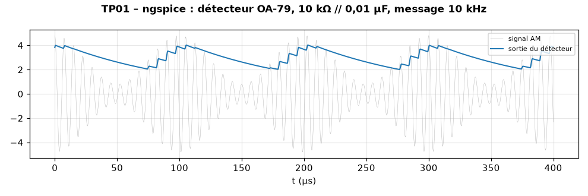
*Écrêtage en diagonale simulé dans ngspice*

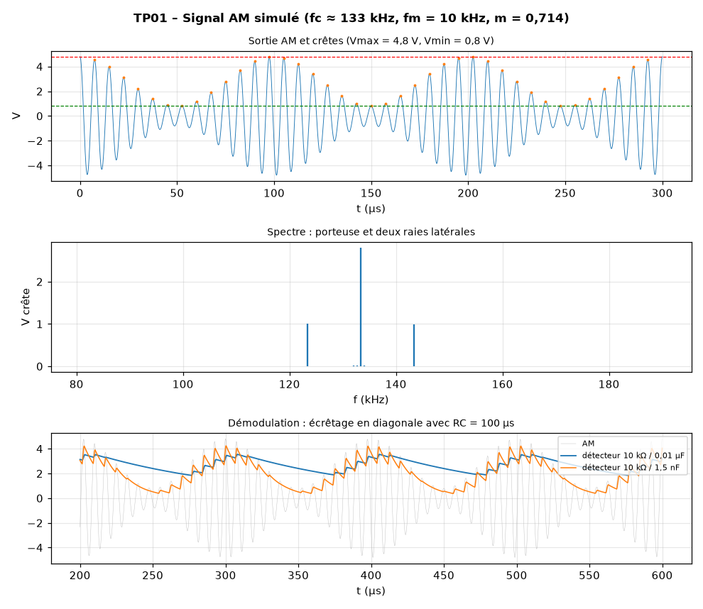
*Signal AM, spectre et détecteur d'enveloppe simulés*

## TP02 – FM – maquette FM Modulation & Demodulation (VCO + PLL)

Vidéo : https://www.youtube.com/watch?v=D5Se6hQdWQA  
Méthode : Modèle comportemental (Python) : VCO idéal, lecture aux curseurs simulée, démodulation par discriminateur de phase.

|  | Grandeur | Vidéo | Simulation | Commentaire |
|---|---|---|---|---|
| ✅ | Porteuse (2,2 div × 10 µs) | 45,45 kHz | 45,45 kHz |  |
| ✅ | Message (4 div × 50 µs) | 5 kHz | 5 kHz |  |
| ✅ | fmax (1,8 div × 10 µs) | ≈ 55 kHz | 55,56 kHz |  |
| ❌ | fmin (3,8 div × 10 µs) | 55 kHz écrit sur la feuille | 26,32 kHz | 1/38 µs = 26,3 kHz : la valeur 55 kHz écrite pour fmin est une erreur de recopie (fmin doit être < fc). |
| ❌ | Symétrie de l'excursion | non discutée | Δf+ = 10,1 kHz ; Δf− = 19,1 kHz ; milieu = 40,9 kHz | Un VCO linéaire donne Δf+ = Δf−. Ici Δf− ≈ 2·Δf+ : la lecture de 3,8 div est douteuse (ou le VCO est très non linéaire). |
| ❌ | Lecture fmin attendue avec un VCO symétrique | 3,8 div (38 µs) | 2,8 div (28 µs) → fmin ≈ 35,7 kHz | Avec Δf = 10,1 kHz des deux côtés, la période la plus longue mesurée sur un cycle vaut ≈ 28 µs, pas 38 µs. |
| ✅ | Lecture fmax simulée (un cycle) | 1,8 div | 1,8 div → 55,4 kHz | un cycle de porteuse dure environ 1/9 de la période du message : la lecture moyenne un peu l’excursion |
| ℹ️ | Indice de modulation β = Δf/fm | non calculé | β = 2,02 (avec Δf+) |  |
| ℹ️ | Bande de Carson B = 2(Δf + fm) | non calculée | 30,2 kHz |  |
| ✅ | Bande à 98 % de puissance (simulée) | — | 30 kHz | comparaison avec la règle de Carson |
| ✅ | Démodulation : message récupéré à 5 kHz | message récupéré montré (TP4) | SINAD 82 dB |  |

Hypothèses de la simulation :

- VCO idéal et linéaire ; le circuit interne de la maquette n'est pas connu.
- Le démodulateur PLL de la maquette est remplacé par un discriminateur de phase idéal (même résultat pour un PLL verrouillé).

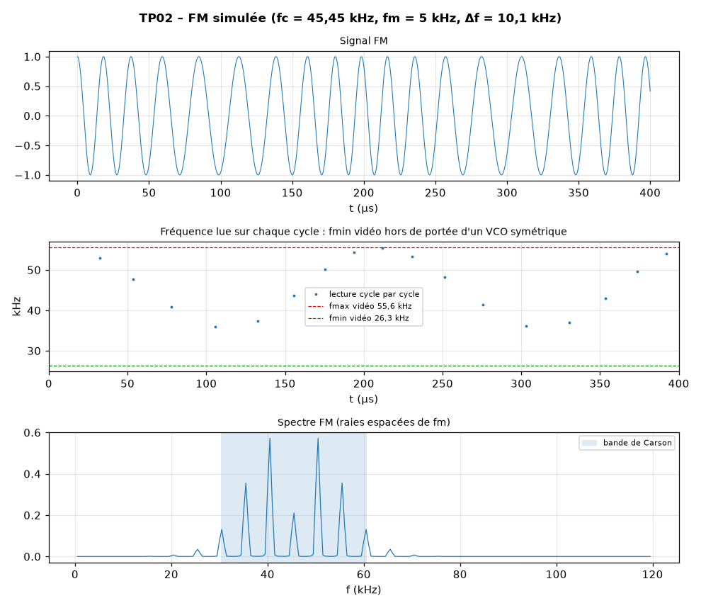
*FM simulée : lecture des fréquences et spectre*

## TP03 – PAM naturel, sample & hold et flat-top – Scientech ST2110

Vidéo : https://www.youtube.com/watch?v=vzdANFkMhSQ  
Méthode : Modèle comportemental (Python) : échantillonnage idéal + filtre de Butterworth.

|  | Grandeur | Vidéo | Simulation | Commentaire |
|---|---|---|---|---|
| ✅ | Critère de Nyquist à fs = 8 kHz | fs ≥ 2·fm (message 1 ou 2 kHz) | fs/fmax = 4 |  |
| ✅ | Critère de Nyquist à fs = 16 kHz | fs ≥ 2·fm (message 1 ou 2 kHz) | fs/fmax = 8 |  |
| ✅ | Critère de Nyquist à fs = 32 kHz | fs ≥ 2·fm (message 1 ou 2 kHz) | fs/fmax = 16 |  |
| ✅ | Critère de Nyquist à fs = 64 kHz | fs ≥ 2·fm (message 1 ou 2 kHz) | fs/fmax = 32 |  |
| ℹ️ | Effet d'ouverture à 2 kHz, fs = 8 kHz | non mesuré | S&H : -0,91 dB ; flat-top τ = Ts/2 : -0,22 dB | le maintien atténue un peu les fréquences hautes du message (sinc) |
| ℹ️ | Effet d'ouverture à 2 kHz, fs = 16 kHz | non mesuré | S&H : -0,22 dB ; flat-top τ = Ts/2 : -0,056 dB | le maintien atténue un peu les fréquences hautes du message (sinc) |
| ✅ | Meilleure restitution quand fs augmente | annoncé dans la vidéo | naturel 1 kHz : 28,5 dB à 8 kHz → 103 dB à 64 kHz |  |

**SINAD du message récupéré après le filtre (simulation)**

| message | fs | naturel | sample & hold | flat-top (τ = Ts/2) |
|---|---|---|---|---|
| 1 kHz | 8 kHz | 28,5 dB (limite) | 41,7 dB (correct) | 27,6 dB (limite) |
| 1 kHz | 16 kHz | 54,1 dB (correct) | > 60 dB (correct) | 53,9 dB (correct) |
| 1 kHz | 32 kHz | > 60 dB (correct) | > 60 dB (correct) | > 60 dB (correct) |
| 1 kHz | 64 kHz | > 60 dB (correct) | > 60 dB (correct) | > 60 dB (correct) |
| 2 kHz | 8 kHz | 23,6 dB (limite) | 29,2 dB (limite) | 21,6 dB (limite) |
| 2 kHz | 16 kHz | 52,5 dB (correct) | > 60 dB (correct) | 51,7 dB (correct) |
| 2 kHz | 32 kHz | > 60 dB (correct) | > 60 dB (correct) | > 60 dB (correct) |
| 2 kHz | 64 kHz | > 60 dB (correct) | > 60 dB (correct) | > 60 dB (correct) |

**Tableau de la vidéo rempli par la simulation (message 1 kHz)**

| fs | Type | Observation prédite |
|---|---|---|
| 16 kHz | naturel | sommets suivant le message ; message récupéré correct (54,1 dB) |
| 16 kHz | sample & hold | sommets plats ; message récupéré correct (> 60 dB) |
| 32 kHz | flat-top | sommets plats ; message récupéré correct (> 60 dB) |
| 64 kHz | flat-top | sommets plats ; message récupéré correct (> 60 dB) |

Hypothèses de la simulation :

- Rapport cyclique des impulsions : 50 % (non indiqué dans la vidéo).
- Filtre de démodulation : Butterworth d'ordre 4, coupure 3,4 kHz (le filtre réel du ST2110 n'est pas documenté).
- SINAD : « correct » ≥ 30 dB, « limite » 20 à 30 dB, « dégradé » < 20 dB (seuils choisis pour la simulation).

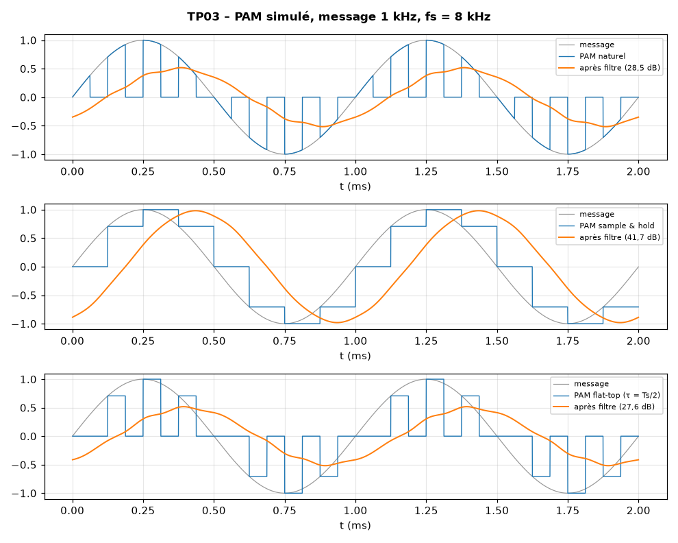
*Les trois formes de PAM et le message récupéré*

## TP04 – PWM – Scientech ST2110 (comparateur message / rampe)

Vidéo : https://www.youtube.com/watch?v=MSSf-RjRAB4  
Méthode : Modèle comportemental (Python) : comparateur entre le message et une rampe, démodulation par filtre passe-bas.

|  | Grandeur | Vidéo | Simulation | Commentaire |
|---|---|---|---|---|
| ✅ | Largeur τ = Ts·(1/2 + m(t)/(2·Ar)) | principe expliqué dans la vidéo | largeurs mesurées sur les impulsions simulées | la largeur varie linéairement avec l'amplitude instantanée du message |
| ℹ️ | Surmodulation | — | si A > 2,5 V les impulsions disparaissent ou fusionnent | l'amplitude du message doit rester inférieure à celle de la rampe |
| ✅ | Démodulation par filtre passe-bas | message récupéré sur la sortie audio | SINAD 31,1 dB (A = 2 V) |  |

**Tableau de la vidéo rempli par la simulation (fs = 8 kHz, message 1 kHz, rampe ± 2,5 V)**

| Amplitude du message | Largeur min | Largeur max | Observation |
|---|---|---|---|
| 500 mV | 50,8 µs | 74,7 µs | théorie 50 µs à 75 µs ; message récupéré 22,1 dB |
| 1 V | 38,6 µs | 86,9 µs | théorie 37,5 µs à 87,5 µs ; message récupéré 28 dB |
| 1,5 V | 25,9 µs | 99,6 µs | théorie 25 µs à 100 µs ; message récupéré 30,8 dB |
| 2 V | 12,7 µs | 113 µs | théorie 12,5 µs à 113 µs ; message récupéré 31,1 dB |

Hypothèses de la simulation :

- Rampe ± 2,5 V et horloge 8 kHz supposées (non lues dans la vidéo) : les largeurs du tableau changent avec ces valeurs, pas la loi linéaire.
- Filtre : Butterworth d'ordre 4, coupure 2,67 kHz (fs/3).

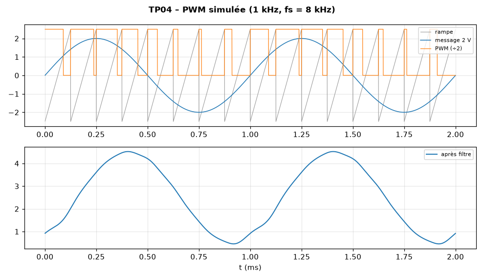
*Génération PWM par comparaison et démodulation*

## TP05 – PWM – Excel Technologies ET-PWM (1 kHz / 8 kHz)

Vidéo : https://www.youtube.com/watch?v=MGXgkWwaYSs  
Méthode : Modèle comportemental (Python) : modulateur à rampe synchronisée sur l'horloge 8 kHz.

|  | Grandeur | Vidéo | Simulation | Commentaire |
|---|---|---|---|---|
| ✅ | Impulsions par période du message | AF 1 kHz, horloge 8 kHz | 8 impulsions de période 125 µs |  |
| ✅ | Démodulation PWM par filtre passe-bas | message 1 kHz récupéré | SINAD 31,1 dB | avec seulement 8 impulsions par période, un filtre d'ordre 4 est nécessaire pour un sinus propre |
| ℹ️ | Valeur moyenne de la PWM | — | 2,51 V (moitié de 5 V : rapport cyclique moyen 50 %) | la composante continue est enlevée par le condensateur de liaison de la maquette |

**Démodulateur : SINAD selon le filtre (message 0,8 × rampe)**

| Coupure | Ordre | SINAD |
|---|---|---|
| 1,5 kHz | 2 | 26,1 dB |
| 1,5 kHz | 4 | 49,5 dB |
| 2,67 kHz | 2 | 16,9 dB |
| 2,67 kHz | 4 | 31,1 dB |
| 3,4 kHz | 2 | 13 dB |
| 3,4 kHz | 4 | 23,2 dB |

Hypothèses de la simulation :

- Rampe synchronisée sur l'horloge 8 kHz ; amplitude du message = 80 % de la rampe.

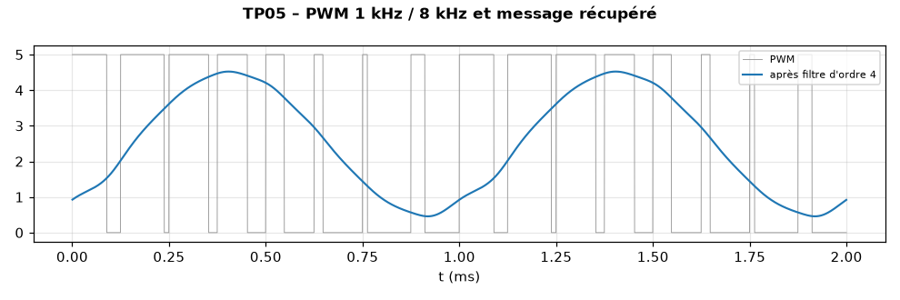
*PWM 1 kHz / 8 kHz et démodulation*

## TP06 – PWM – Akademika DCL-08 (caractéristique largeur / tension, déphasage)

Vidéo : https://www.youtube.com/watch?v=Q6VduGGqPRE  
Méthode : Analyse des relevés (régression linéaire) + modèle de filtre de démodulation.

|  | Grandeur | Vidéo | Simulation | Commentaire |
|---|---|---|---|---|
| ✅ | Largeur proportionnelle à la tension (droite croissante) | courbe demandée : droite croissante | w = 0,0219·V + 0,166 ; R² = 0,977 | écart maximal à la droite : 0,0084 (unité de la feuille). La relation est bien linéaire. |
| ⚠️ | Unité « secs » | 0,18 à 0,26 « secs » | 0,18 à 0,26 ms | des largeurs de 0,2 s seraient impossibles avec une horloge de l'ordre du kHz : l'unité est très probablement la ms |
| ✅ | Déphasage du signal démodulé | 0,6 × 250 µs = 150 µs | 150 µs = 54° à 1 kHz | valeur cohérente avec un filtre de démodulation de quelques kHz (voir tableau) |

**Relevés de la vidéo et droite ajustée**

| V (V) | largeur notée | droite | écart |
|---|---|---|---|
| 0,6 | 0,18 | 0,179 | 0,001 |
| 1,4 | 0,2 | 0,197 | 0,0035 |
| 2,4 | 0,21 | 0,218 | -0,0084 |
| 3,3 | 0,24 | 0,238 | 0,0018 |
| 4,2 | 0,26 | 0,258 | 0,0021 |

**Déphasage mesuré 0,6 div × 250 µs = 150 µs : coupure du filtre qui le produit**

| message | déphasage | filtre ordre 1 | Butterworth ordre 2 | Butterworth ordre 4 |
|---|---|---|---|---|
| 500 Hz | 27° | 981 Hz | 1,55 kHz | 2,79 kHz |
| 1 kHz | 54° | 727 Hz | 1,64 kHz | 2,82 kHz |

Hypothèses de la simulation :

- La fréquence du message pendant la mesure de déphasage (500 Hz ou 1 kHz) n'est pas certaine : les deux cas sont donnés.

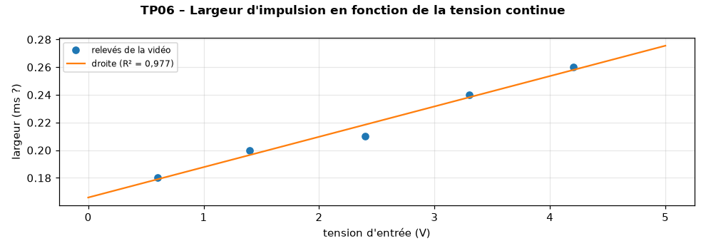
*Caractéristique largeur / tension relevée dans la vidéo*

## TP07 – FM avec le générateur de fonctions ICL8038

Vidéo : https://www.youtube.com/watch?v=eaoYraDUfKk  
Méthode : Formule de la fiche technique + VCO comportemental (Python) : courants de charge proportionnels à V+ − V(broche 8).

|  | Grandeur | Vidéo | Simulation | Commentaire |
|---|---|---|---|---|
| ✅ | Fréquence libre (RA = RB = 10 kΩ, C = 1 nF) | f ≈ 0,3/(R·C) ≈ 30 kHz (calculé dans le cours) | 30 kHz | formule complète f = 1/[(5/3)·RA·C·(1 + RB/(2RA − RB))] |
| ✅ | Rapport cyclique avec RA = RB | signal carré / triangle symétrique | t1 = 16,7 µs, t2 = 16,7 µs → 50 % | t1 = (5/3)·RA·C et t2 = (5/3)·RA·RB·C/(2RA − RB) : symétrique si RA = RB |
| ℹ️ | Sensibilité du VCO | tableau V / f à compléter | K = f0/(0,2·Vs) = 15 kHz/V | la fréquence baisse quand la tension de la broche 8 monte vers V+ |
| ℹ️ | Exemple : m(t) = 0,5 V crête à 1 kHz sur la broche 8 | fmax, fmin, Δf, β à calculer | fmax = 37,5 kHz ; fmin = 22,5 kHz ; Δf = 7,49 kHz ; β = 7,49 | valeurs prédites pour remplir le tableau ; Δf = K·Am |
| ⚠️ | Valeur 6,6 kΩ entre les broches 7 et 8 | lue 6,6 kΩ (peut-être 6,8 kΩ) | 6,6 kΩ n'est pas une valeur normalisée | la série E12 contient 6,8 kΩ ; cette résistance règle la polarisation FM, pas f0 (écart < 3 %) |
| ✅ | [ngspice] Fréquence libre (RA = RB = 10 kΩ, C = 1 nF, 10 V) | ≈ 30 kHz (formule) | 29,99 kHz | modèle comportemental construit d'après le schéma interne de la fiche technique |
| ✅ | [ngspice] 6,6 kΩ ou 6,8 kΩ entre les broches 7 et 8 (m(t) = 0,5 V crête) | valeur lue douteuse | 6,6 kΩ : 22,5 kHz à 37,5 kHz ; 6,8 kΩ : 22,5 kHz à 37,5 kHz | le générateur impose la tension de la broche 8 à travers 10 µF : la résistance ne change pas la fréquence |
| ℹ️ | [ngspice] Message de la vidéo : 4 Vpp à 500 Hz sur la broche 8 | fmax, fmin à mesurer | fréquence de 2,32 kHz à 60,2 kHz | Au repos V+ − V8 = 2 V ; avec 2 V crête, cet écart varie de 0 à 4 V : la fréquence descend presque à zéro sur une alternance et double sur l'autre. C'est une modulation très forte et non linéaire. |

**Caractéristique du VCO prédite : f en fonction de la variation de V(broche 8) (V+ = 10 V)**

| ΔV broche 8 (V) | f |
|---|---|
| -1 | 45 kHz |
| -0,5 | 37,5 kHz |
| 0 | 30 kHz |
| 0,5 | 22,5 kHz |
| 1 | 15 kHz |

Hypothèses de la simulation :

- RA, RB et C réels non lisibles dans la vidéo : RA = RB = 10 kΩ, C = 1 nF supposés.
- Alimentation 10 V (schéma) ; broches 7 et 8 au repos à 0,2·Vs sous V+ (fiche technique).
- VCO idéal et linéaire ; la fiche technique annonce une linéarité de l'ordre de 0,5 % sur une large plage.

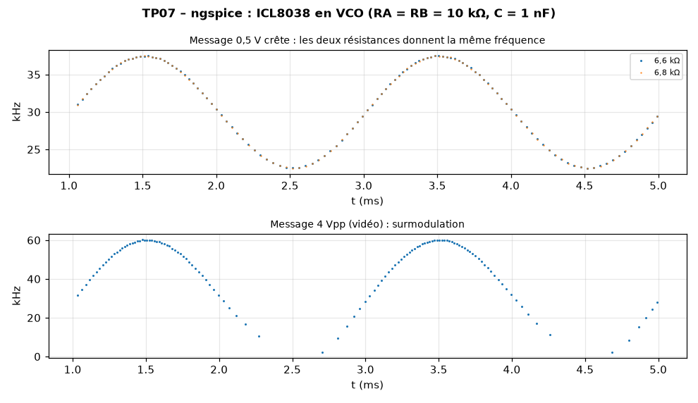
*Fréquence instantanée de l'ICL8038 simulé dans ngspice*

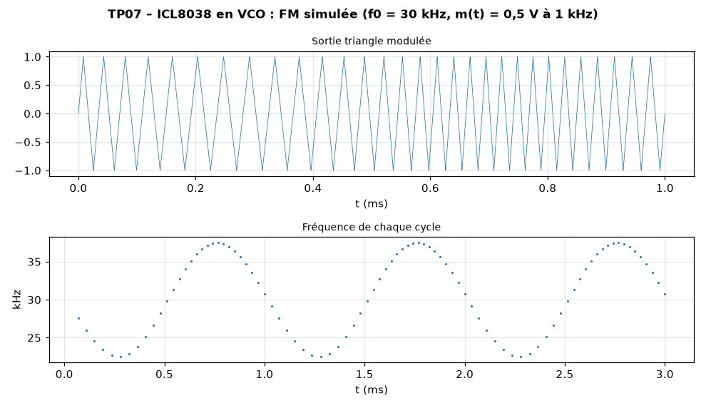
*ICL8038 utilisé comme VCO*

## TP08 – PAM – maquette Excel Technologies (1 kHz / 8 kHz)

Vidéo : https://www.youtube.com/watch?v=eeunlmRM_LA  
Méthode : Modèle comportemental (Python) : interrupteur analogique commandé par une horloge 0/1.

|  | Grandeur | Vidéo | Simulation | Commentaire |
|---|---|---|---|---|
| ✅ | Nyquist | message 1 kHz, horloge 8 kHz | fs/fm = 8 ≥ 2 |  |
| ℹ️ | Impulsions par période du message | — | 8 impulsions | 8 échantillons par période : l'enveloppe des impulsions dessine bien le sinus |
| ⚠️ | « Seule l'alternance positive apparaît » (dit à l'oral) | horloge unipolaire 0/1 → seulement l'alternance positive | interrupteur idéal : impulsions positives ET négatives | Une horloge 0/1 commande l'interrupteur mais ne fixe pas le signe des impulsions : un interrupteur analogique laisse passer les deux alternances. L'observation de la vidéo s'explique si l'étage de la maquette est alimenté en unipolaire (écrêtage) ou si le message porte un décalage continu. À vérifier sur la maquette. |
| ℹ️ | Message récupéré après filtre (cas idéal) | démodulation non montrée | SINAD 28,5 dB |  |

Hypothèses de la simulation :

- Rapport cyclique 50 % ; filtre Butterworth d'ordre 4 à 3,4 kHz pour la démodulation.

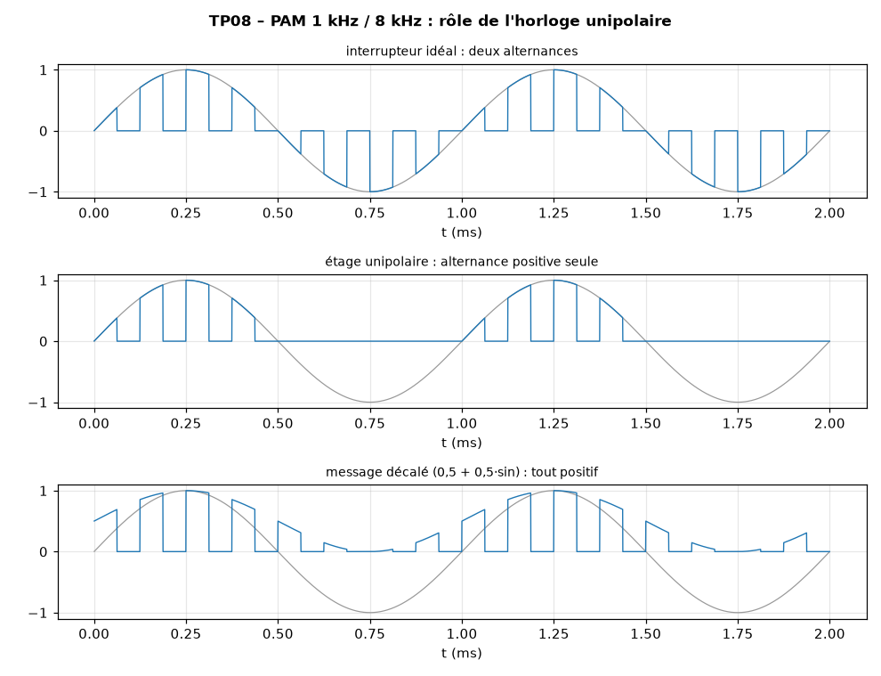
*Trois hypothèses pour expliquer l'alternance positive seule*

## TP09 – Démodulation FM par boucle à verrouillage de phase LM565

Vidéo : https://www.youtube.com/watch?v=3HIn2Pt3ySg  
Méthode : Formules de la fiche technique + PLL comportementale (Python).

|  | Grandeur | Vidéo | Simulation | Commentaire |
|---|---|---|---|---|
| ✅ | Fréquence libre du VCO f0 = 1,2/(4·R1·C1) | porteuse réglée à 9,4 kHz | 9,387 kHz | écart -0,14 % |
| ✅ | Exemple de la fiche technique (R = 20 kΩ, C = 1,5 nF) | — | 10 kHz | la fiche technique annonce 10 kHz : la formule est vérifiée |
| ✅ | Plage de verrouillage à ±12 V : fL = ±8·f0/Vtot | ±12 V (écran) / « ±4 V » (oral) | ±3,13 kHz → de 6,26 kHz à 12,5 kHz | valeur du schéma et de l'écran |
| ❌ | Plage de verrouillage à ±4 V : fL = ±8·f0/Vtot | ±12 V (écran) / « ±4 V » (oral) | ±9,39 kHz → de 0 Hz à 18,8 kHz | ±4 V est hors de la plage d'alimentation (±5 à ±12 V) : c'est une erreur de transcription |
| ✅ | Message récupéré à la sortie (broche 7) | sinus 1 kHz récupéré à l'oscilloscope | 290 mV crête ; SINAD 24,6 dB brut, 30,2 dB après un filtre passe-bas de 3 kHz | amplitude attendue Δf/Ko = 321 mV. La sortie brute porte une forte ondulation à 2·f0 ≈ 18,8 kHz qu'un petit filtre passe-bas après la broche 7 enlève. |
| ⚠️ | Branchement de C1 | C1 relié à la masse dans la vidéo | fiche technique : C1 entre broche 9 et −V (broche 1) | le circuit fonctionne aussi avec C1 à la masse, mais f0 peut s'écarter un peu de la formule |
| ✅ | [ngspice] Fréquence libre du VCO, C1 relié à la masse / à −12 V | 9,4 kHz | 9,369 kHz / 9,39 kHz | avec des alimentations stables, la masse et −12 V sont deux points fixes : le condensateur voit la même variation |
| ✅ | [ngspice] Message récupéré sur la broche 7 (Δf = 1 kHz) | sinus 1 kHz récupéré | 289 mV crête ; SINAD 26,5 dB | amplitude attendue Δf/Ko = 321 mV (Ko = 3,11 kHz/V sous ±12 V) |
| ✅ | [ngspice] Plage de capture simulée | estimation √(2π·fL/τ)/2π = ±957 Hz | accrochage jusqu'à ±1 kHz | la plage de verrouillage (boucle déjà accrochée) est plus large : ±3,13 kHz d'après la fiche technique. Avec C2 = 150 nF, la porteuse doit être réglée à moins d'environ 1 kHz de f0 pour que la boucle s'accroche. |

**ngspice : la boucle s'accroche-t-elle sur une porteuse pure décalée de f0 (départ décroché) ?**

| Écart à f0 | Boucle |
|---|---|
| ± 500 Hz | accrochée |
| ± 1 kHz | accrochée |
| ± 1,5 kHz | non accrochée |
| ± 2 kHz | non accrochée |
| ± 3 kHz | non accrochée |

Hypothèses de la simulation :

- Excursion de fréquence du générateur non lue dans la vidéo : Δf = 1 kHz supposé.
- Ko = 50·f0/Vc (fiche technique) ; comparateur de phase ±1 V ; résistance interne broche 7 ≈ 3,6 kΩ ; C2 = 150 nF (schéma).

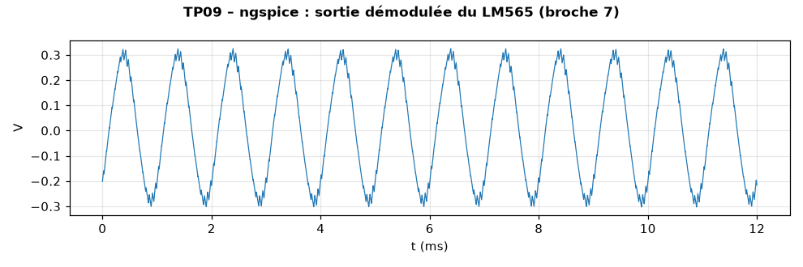
*Message de 1 kHz récupéré par le LM565 simulé dans ngspice*

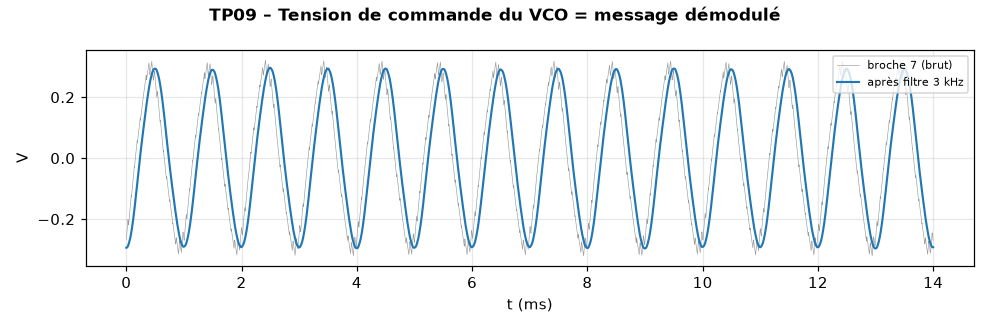
*Sortie du LM565 simulé (message 1 kHz)*

## TP10 – FM avec un NE555 (astable, message sur la broche 5)

Vidéo : https://www.youtube.com/watch?v=xSqwbJl5yzU  
Méthode : Simulation pas à pas (Python) du 555 : comparateurs, bascule, décharge, diode 1N4007 (modèle de Shockley), broche 5 modulée.

|  | Grandeur | Vidéo | Simulation | Commentaire |
|---|---|---|---|---|
| ℹ️ | Tension de repos de la broche 5 | non mesurée | 2,5 V (au lieu de 2/3·Vcc = 3,33 V, à cause de R3 = 10 kΩ) | seuils de basculement : 2,5 V et 1,25 V |
| ❌ | Fréquence sans message (C1 = 0,1 µF) | ≈ 11 kHz mesurés | 5,4 kHz | écart -51 % : les valeurs lues sur le schéma ne donnent pas 11 kHz |
| ⚠️ | Condensateur qui donnerait 11 kHz | C1 lu « 0,1 µF » | 49,1 nF | f est inversement proportionnelle à C1 : un condensateur de 47 nF (valeur normalisée) donnerait ≈ 11 kHz ; à vérifier sur la photo du montage |
| ℹ️ | Hypothèse C1 = 47 nF | ≈ 11 kHz | 11,5 kHz | hypothèse compatible avec la mesure de la vidéo |
| ❌ | Rapport cyclique avec la diode | « diode : charge et décharge égales » | 39,3 % | Avec R3 = 10 kΩ, les seuils sont 2,5 V et 1,25 V : la charge vers ≈ 4,4 V (5 V − diode) est plus rapide que la décharge vers 0 V, même avec R1 = R2. Sans R3 (seuils 3,33 V et 1,67 V) on obtiendrait ≈ 56 %. |
| ⚠️ | Amplitude de sortie | ≈ 5,4 V avec Vcc = 5 V | NE555 bipolaire : niveau haut ≈ Vcc − 1,7 V ≈ 3,3 V | 5,4 V dépasse l'alimentation : lecture crête-à-crête avec dépassement, sonde mal réglée ou 555 CMOS |
| ✅ | Sens de la modulation | fréquence basse sur l'alternance positive | broche 5 plus haute → seuils plus hauts → charge plus longue → fréquence plus basse |  |
| ℹ️ | Linéarité | — | Δf asymétrique : la charge ralentit fortement quand Vcv approche Vcc − 0,6 V | avec 1,5 V crête autour de 2,5 V, la broche 5 monte à 4 V : le 555 est très non linéaire ; un message plus faible serait plus fidèle |
| ❌ | [ngspice] Fréquence sans message (C1 = 0,1 µF) | ≈ 11 kHz | 5,49 kHz | même résultat que la simulation Python (5,4 kHz) avec un autre simulateur et une vraie diode SPICE |
| ❌ | [ngspice] Rapport cyclique | « charge et décharge égales » | 40,8 % | Python : 39,3 % |
| ❌ | [ngspice] Niveau haut de la sortie | ≈ 5,4 V | 3,3 V | un NE555 bipolaire sous 5 V ne peut pas sortir 5,4 V |
| ✅ | [ngspice] Fréquence avec C1 = 47 nF | ≈ 11 kHz | 11,7 kHz |  |
| ℹ️ | [ngspice] FM avec message 200 Hz, 3 Vpp (C1 = 0,1 µF) | fmin / fmax à mesurer | fmin = 2,96 kHz ; fmax = 8,17 kHz ; Δf = 2,6 kHz |  |

**Tableau de la vidéo rempli par la simulation (C1 = 0,1 µF, message 200 Hz, 3 Vpp)**

| Segment | Fréquence simulée |
|---|---|
| Alternance positive (fmin) | 2,86 kHz |
| Alternance négative (fmax) | 7,74 kHz |
| Δf = (fmax − fmin)/2 | 2,44 kHz |

**Tableau de la vidéo rempli par la simulation (C1 = 47 nF, message 200 Hz, 3 Vpp)**

| Segment | Fréquence simulée |
|---|---|
| Alternance positive (fmin) | 6,11 kHz |
| Alternance négative (fmax) | 15,6 kHz |
| Δf = (fmax − fmin)/2 | 4,73 kHz |

Hypothèses de la simulation :

- Pont interne 5 kΩ / 5 kΩ / 5 kΩ du 555 ; transistor de décharge saturé à 0,1 V.
- Diode 1N4007 : Is = 7 nA, n = 1,8 ; sortie du générateur idéale.

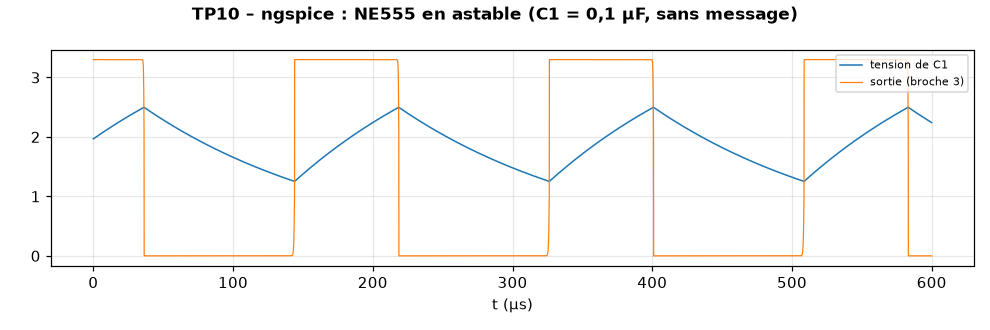
*Simulation ngspice du 555 avec les valeurs du schéma*

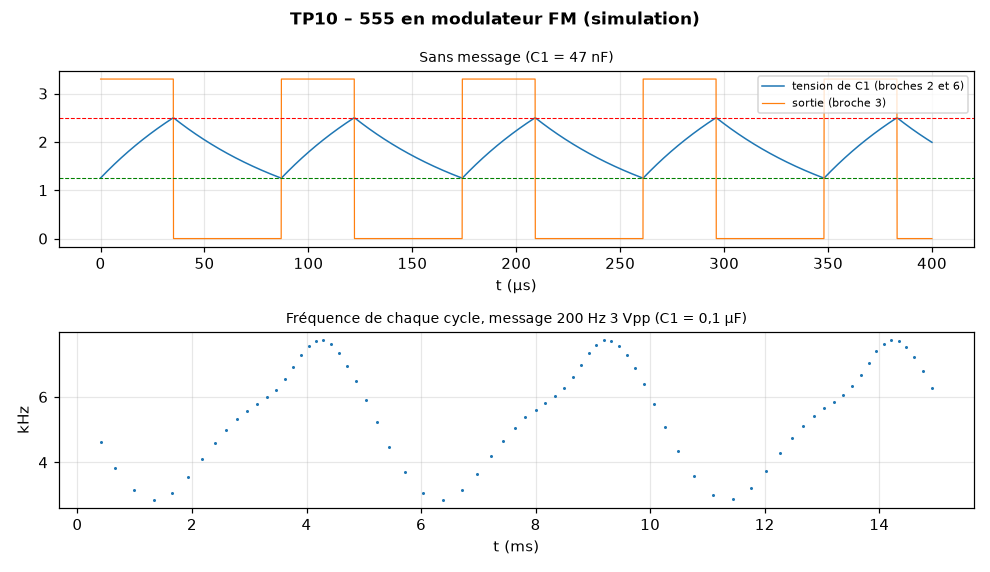
*Astable 555 et fréquence instantanée modulée*

## TP11 – AM à transistor BC107BP + détecteur d'enveloppe (ngspice)

Vidéo : https://www.youtube.com/watch?v=51hQ_KS0t9I  
Méthode : Simulation ngspice du schéma de la vidéo (modèles génériques BC107B et 1N4001).

|  | Grandeur | Vidéo | Simulation | Commentaire |
|---|---|---|---|---|
| ❌ | Accord du circuit L1 // C1 | porteuse 10 kHz | f0 = 1/(2π√(LC)) = 7,12 kHz | le circuit accordé est réglé -29 % sous la porteuse : le gain à 10 kHz est réduit. Il faudrait C1 ≈ 5,1 nF (ou L1 ≈ 25 mH) pour accorder sur 10 kHz. |
| ❌ | Calcul de μ avec Emax = 11,8 V et Emin = 11 V | μ = 0,029 annoncé | μ = 0,0351 | 0,029 venait d'une mesure précédente (Vmax = 12,3 V) ; avec les valeurs affichées μ ≈ 0,035 |
| ⚠️ | μ en retirant la tension continue du collecteur (8,3 V) | μ ≈ 0,03 (tensions absolues) | μ = (11,8 − 11)/(11,8 + 11 − 2 × 8,3) = 0,129 | Le collecteur est polarisé à Vcc par L1. En couplage continu (DC) à l'oscilloscope, les crêtes lues contiennent ces 8,3 V : la formule (Emax − Emin)/(Emax + Emin) sous-estime alors μ d'un facteur ≈ 4. |
| ✅ | Détecteur : 1/fc ≪ R5·C2 ≪ 1/fm | 1/fc = 100 µs, 1/fm = 2 ms | R5·C2 = 500 µs | condition respectée (5 périodes de porteuse, 1/4 de période du message) |
| ✅ | [ngspice] Emax / Emin au collecteur, modulateur seul (8,3 V) | ≈ 11,8 V / ≈ 11 V | 10,9 V / 10,3 V | crêtes de chaque cycle de porteuse sur 10 ms |
| ✅ | [ngspice] μ avec la formule de la vidéo (tensions absolues) | ≈ 0,03 | μ = 0,0278 | la simulation retrouve la valeur de la vidéo avec un BC107 ordinaire |
| ✅ | [ngspice] μ sur la seule partie alternative | 0,129 en corrigeant la vidéo | μ = 0,129 | tension continue du collecteur : 8,31 V. Le vrai taux de modulation est ≈ 13 %, pas 3 %. |
| ℹ️ | [ngspice] Même modulateur sous 12 V (valeur du schéma) | — | Emax = 14,6 V ; Emin = 12,9 V ; μ (partie alternative) = 0,468 |  |
| ❌ | [ngspice] Démodulateur du schéma branché sur la sortie AM | démodulateur décrit sur la feuille (circuit séparé) | message 43,9 mV crête ; enveloppe au collecteur 46,5 mV crête (à vide : 294 mV) | Le détecteur ne prend du courant qu'aux crêtes et écrase la tension du circuit accordé, même avec R5 = 10 kΩ. Il faut un étage tampon (émetteur suiveur) entre la sortie AM et le détecteur. |

**Démodulateur branché sur la sortie AM (collecteur à vide : 10,9 V / 10,3 V, variation d'enveloppe 294 mV crête)**

| Détecteur | Emax / Emin au collecteur | Continu en sortie | Message 500 Hz (crête) |
|---|---|---|---|
| schéma : R5 = 500 Ω, C2 = 1 µF | 7,73 V / 7,63 V | 6,93 V | 43,9 mV |
| R5 = 10 kΩ, C2 = 47 nF | 8,85 V / 8,71 V | 7,74 V | 36,2 mV |

Hypothèses de la simulation :

- Modèles génériques BC107B et 1N4001 ; résistance série de L1 : 50 Ω (non indiquée).
- μ calculé comme dans la vidéo avec les crêtes absolues, puis sur la seule partie alternative.

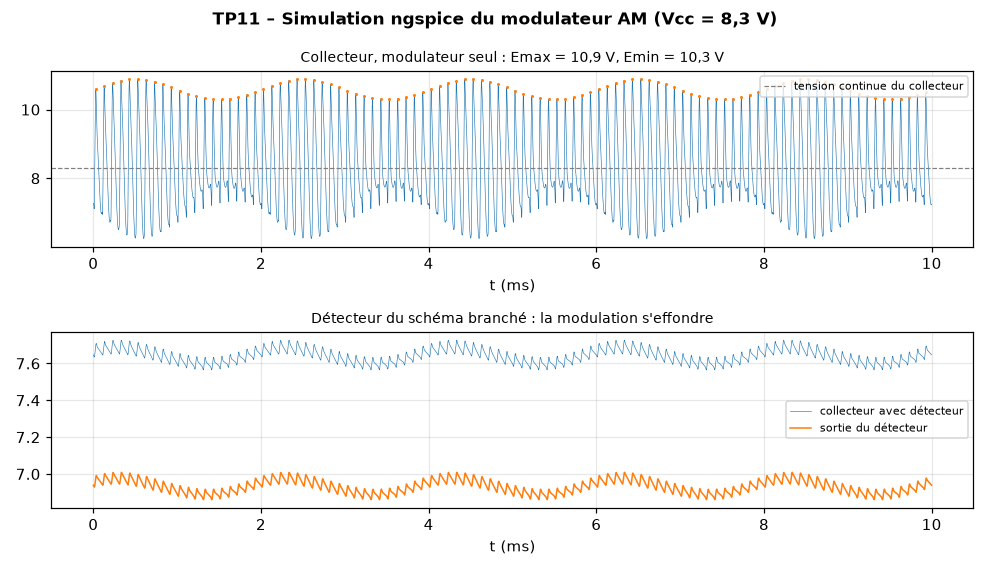
*Modulateur AM à BC107 simulé avec ngspice*

## TP12 – PAM et démodulation – Scientech ST2110 (8 / 16 / 32 / 64 kHz)

Vidéo : https://www.youtube.com/watch?v=tbTM0nnaiV4  
Méthode : Modèle comportemental (Python) : sorties Sample, Sample & Hold, Flat-Top + filtre.

|  | Grandeur | Vidéo | Simulation | Commentaire |
|---|---|---|---|---|
| ✅ | Démodulation à 8 kHz et 16 kHz (affichées) | message récupéré dans les deux cas | 8 kHz : 28,5 dB ; 16 kHz : 54,1 dB | à 8 kHz, une petite ondulation résiduelle reste visible ; à 16 kHz le sinus est propre |
| ✅ | Câblage : message broche 2, impulsions broche 1 | dit à l'oral | PAM = m(t) × p(t) | le modulateur multiplie le message par le train d'impulsions ; l'ordre des broches est propre à la maquette |
| ℹ️ | Retard du message récupéré (« RC delay ») | retard visible, non chiffré | 123 µs soit 44,3° à 1 kHz | retard de groupe du filtre de démodulation |

**Tableau de la vidéo rempli par la simulation (message 1 kHz)**

| Fréquence d'impulsion | Sample | Sample & Hold | Flat-Top |
|---|---|---|---|
| 8 kHz | 28,5 dB (limite) | 41,7 dB (correct) | 27,6 dB (limite) |
| 16 kHz | 54,1 dB (correct) | > 60 dB (correct) | 53,9 dB (correct) |
| 32 kHz | > 60 dB (correct) | > 60 dB (correct) | > 60 dB (correct) |
| 64 kHz | > 60 dB (correct) | > 60 dB (correct) | > 60 dB (correct) |

Hypothèses de la simulation :

- Rapport cyclique 50 %, filtre Butterworth d'ordre 4 à 3,4 kHz (non documenté pour le ST2110).

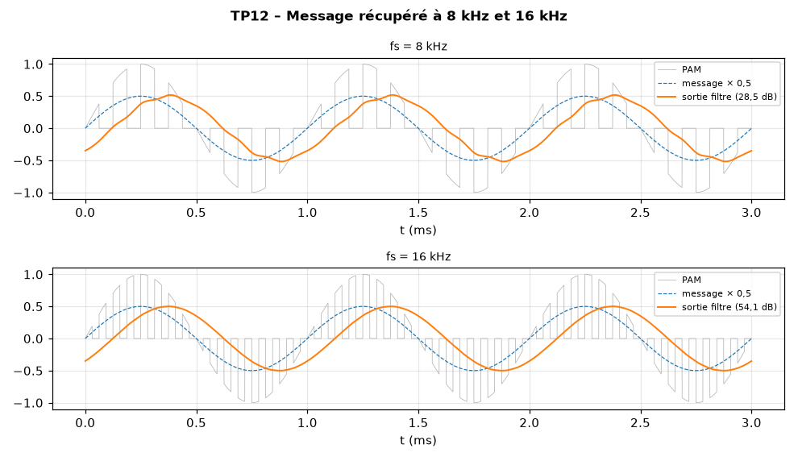
*Démodulation PAM : retard du filtre et ondulation résiduelle*

## TP13 – PAM avancé – Vinytics CT-PAM ADV (fs 2 à 64 kHz, filtres d'ordre 2 et 4)

Vidéo : https://www.youtube.com/watch?v=OZSDbqnP3Wo  
Méthode : Modèle comportemental (Python) : PAM naturel + filtres de Butterworth d'ordre 2 et 4 ; balayage de la fréquence de coupure inconnue.

|  | Grandeur | Vidéo | Simulation | Commentaire |
|---|---|---|---|---|
| ℹ️ | Fréquence du générateur | réglé sur 1 kHz, mesuré 959 Hz | écart -4,1 % | écart du générateur de la maquette (réglage du potentiomètre), sans effet sur la conclusion |
| ✅ | Résultats annoncés (ordre 2 correct à 64/32 kHz, ordre 4 correct à 16 kHz, dégradé à 4 kHz) | annoncés dans la vidéo | reproduits pour une coupure de 2 kHz à 5 kHz | si l'on exige aussi que l'ordre 2 ne suffise plus à 16 kHz (raison du passage à l'ordre 4) : 3 kHz à 5 kHz |
| ℹ️ | fs = 2 kHz (limite de Nyquist pour 1 kHz) | non commenté | fs = 2·fm : échantillons à phase fixe, message non récupérable | il faut fs > 2·fm, et en pratique fs ≥ 4 à 8·fm avec un filtre réel |
| ✅ | fs = 4 kHz : image à fs − fm = 3 kHz | signal dégradé | image trop proche de 1 kHz pour être filtrée |  |

**Message 1 kHz récupéré, coupure 4 kHz (simulation)**

| fs | Filtre d'ordre 2 | Filtre d'ordre 4 |
|---|---|---|
| 2 kHz | 6,31 dB (dégradé) | 5,72 dB (dégradé) |
| 4 kHz | 3,68 dB (dégradé) | 3,7 dB (dégradé) |
| 8 kHz | 12,6 dB (dégradé) | 22,9 dB (limite) |
| 16 kHz | 24,8 dB (limite) | 48,5 dB (correct) |
| 32 kHz | 37 dB (correct) | > 60 dB (correct) |
| 64 kHz | 49,1 dB (correct) | > 60 dB (correct) |

Hypothèses de la simulation :

- Fréquence de coupure des filtres de la maquette inconnue : balayée de 1,5 à 5 kHz.
- Type de filtre : Butterworth ; rapport cyclique 50 % ; seuils SINAD 30 dB / 20 dB.

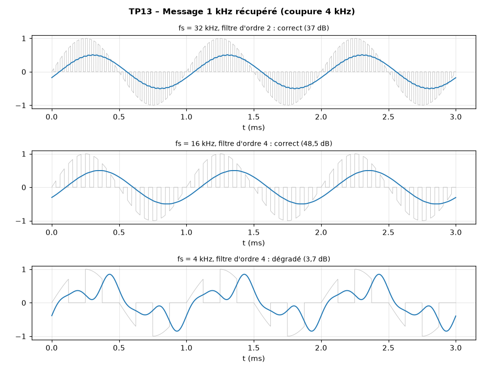
*Effet de fs et de l'ordre du filtre sur le message récupéré*
